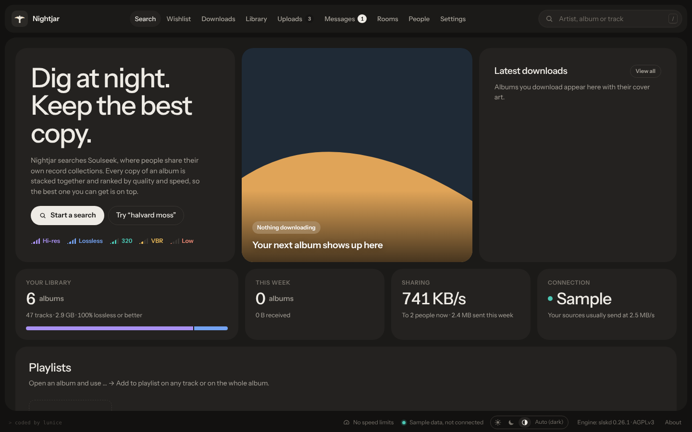
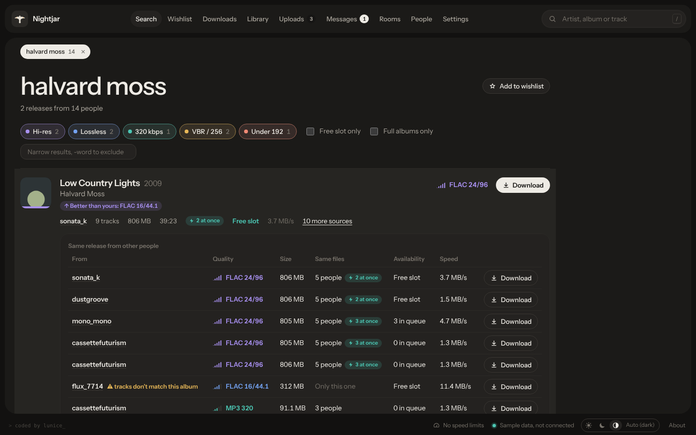
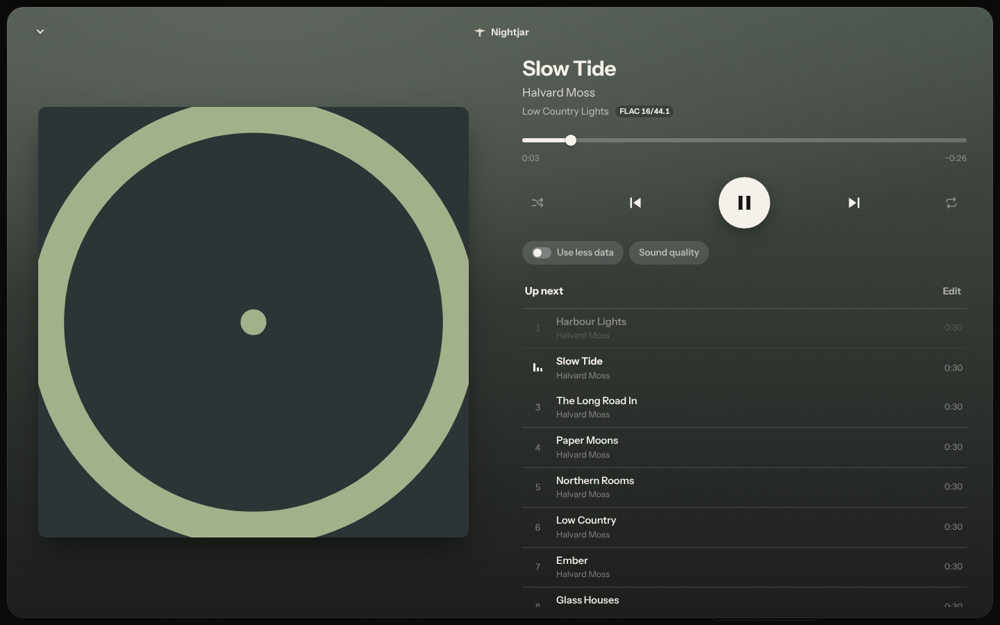
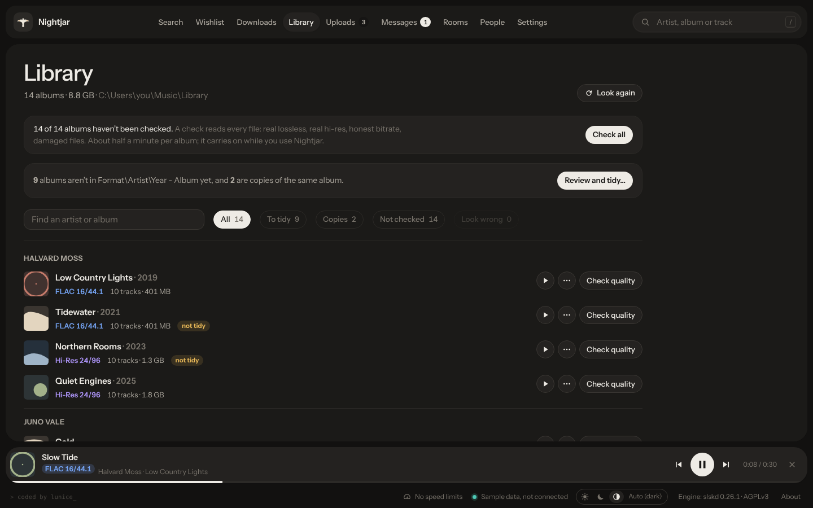
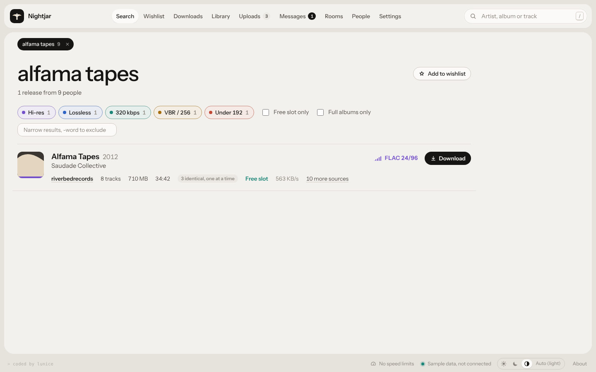
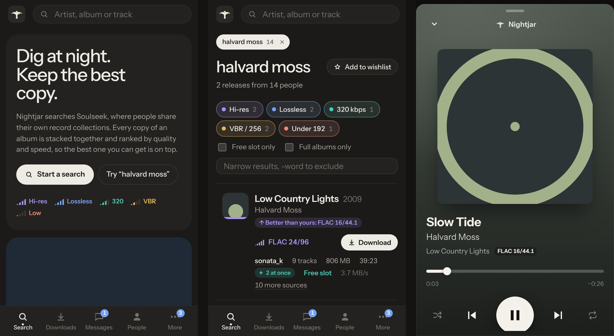
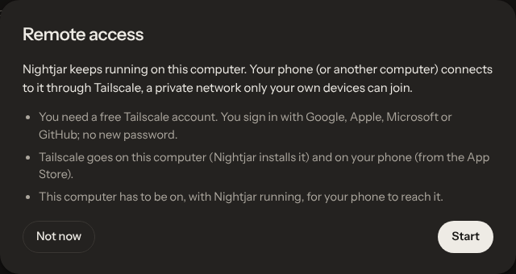
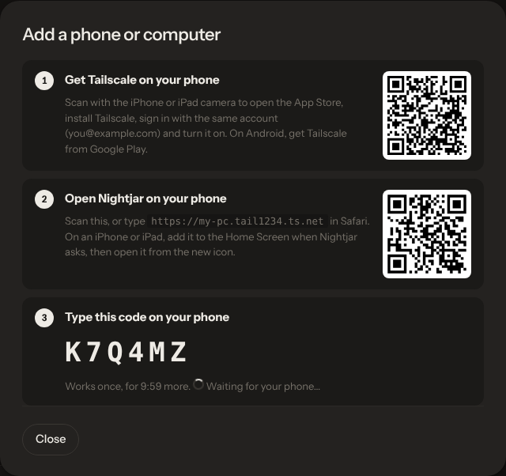

# Nightjar

A modern Soulseek client for Windows, with your music on your phone wherever you are.

Nightjar finds music on Soulseek, a network of people sharing their own record collections, downloads the best copy it can find, keeps your library in order, and plays it on your computer, phone or iPad.

Nightjar is a new interface on top of [slskd](https://github.com/slskd/slskd), an open source Soulseek engine, used without changes. It is not the official Soulseek client and isn't affiliated with Soulseek, slskd or Tailscale.

**[Download the latest version](https://github.com/lunice-dev/nightjar/releases/latest)** — `Nightjar-Setup-x.y.z.exe`, for Windows 10 and 11. No admin rights, no Soulseek account needed beforehand: Nightjar walks you through the first start, and updates itself afterwards.



## What's new in 0.8

- **Remote access.** Use Nightjar on your phone, iPad or another computer when you're away from home: search, download, browse your library and play your music. It goes through [Tailscale](https://tailscale.com), a free private network between your own devices; nothing is opened to the internet. Settings walks you through it and installs Tailscale for you. [How to set it up ↓](#remote-access-step-by-step)
- **Listen to your music** on any device: a big player with the album's colours, lock-screen controls, shuffle, repeat and a queue. "Use less data" sends smaller copies when you're on mobile data.
- **Playlists**, kept on your computer so every device sees the same ones, and backed up automatically.
- **Fake albums caught.** A folder named after one album that holds another is flagged before you download it, and stopped while it downloads if its files say otherwise.
- **Feels like an app** on a phone: it goes on the Home Screen, you swipe between tabs, and the PC and iPad get layouts of their own.
- **Safer updates.** Every update is signed; Nightjar won't install one that isn't.

## What it does

### Finding and downloading
- **Albums, not loose files.** Results are grouped by folder and shown as albums. Everyone's copies of the same album are stacked into one row and ranked: quality first, then a free slot, then speed.
- **Quality you can see.** Hi-res, lossless, 320, VBR and low bitrate each have their own colour and filter.
- **Several people at once.** When others have exactly the same files, Nightjar downloads different tracks from up to three of them together, and moves a slow track to someone faster.
- **Whole albums.** Download asks for the complete folder, and warns when a copy has only part of the album.
- **Fakes stay at the bottom.** Copies whose track names don't match the album (checked against [MusicBrainz](https://musicbrainz.org) or other people's copies) are marked and ask before downloading. While an album downloads, the first track's tags are read as it arrives; if they name another album, the rest pauses and you choose. People who sent you a fake are remembered and ranked last.
- **Wishlist.** Keeps looking for albums nobody shares yet and tells you when they turn up.

### Your library
- **Check quality.** Tells a real lossless file from an MP3 in disguise, real hi-res from upsampled, real 24-bit from padded 16-bit, and finds damaged files (FLAC, WAV, MP3).
- **In order.** Puts downloads into `Format\Artist\Year - Album`, reviews a whole existing library before moving anything, and every move can be undone. Search shows what you already have, and when a copy is better than yours.

### Listening
- **Play anything you have**: your library, your downloads, your shared folders. Tap a cover to see the album; tap a track to play from there.
- **Play next, Add to queue, Add to playlist** for a track or a whole album.
- **On a phone**: lock-screen and Control Centre controls, smooth seeking, and "Use less data" (AAC copies made by your computer). FLAC plays as it is at home; the player shows exactly what quality reaches your ears.

### Sharing
- **Leech rules and friends first** decide who gets your uploads. Uploads shows who downloads what, grouped by day, and lets you block someone in one click.
- **A real Windows app.** Its own window, an icon next to the clock, sharing and downloading in the background, and it can start with Windows.

## Screenshots

| Search: every copy of an album in one row | The player on a computer or an iPad held sideways |
|---|---|
|  |  |
| **Your library, checked and tidied** | **Light theme** |
|  |  |

On a phone: home, search and the player.



## Remote access, step by step

Remote access lets your phone, iPad or another computer use the Nightjar running on your PC, from anywhere. Your PC does the work (searching, downloading, storing your music); the phone is a window onto it.

It goes through **Tailscale**, a free service that links your own devices in a private network. Only devices signed in to *your* Tailscale account can reach your PC, and every device also has to be signed in to Nightjar. Nothing is opened to the internet, and no router settings are needed.

### What you need
- Your PC with Nightjar 0.8 or later, **switched on and with Nightjar running** whenever you want to use it from elsewhere.
- A free **Tailscale account**. You make it during setup and sign in with Google, Apple, Microsoft or GitHub; there's no new password to remember.
- On the phone: the **Tailscale app** (App Store or Google Play), signed in to the **same** account.

### 1. On your PC: turn it on

Open Nightjar → **Settings** → **Remote access** → **Set up remote access**, and follow the guide.



1. **Install Tailscale.** Nightjar downloads Tailscale's official installer, checks it's signed by Tailscale, and runs it. Windows asks for permission once.
2. **Sign in to Tailscale.** Your browser opens Tailscale's sign-in page. Make your account there (or sign in), then come back to Nightjar.
3. **Turn on remote access.** The first time, Tailscale asks you to allow secure (https) addresses for your account: Nightjar opens that page, you click to allow it, then press **I've allowed it**. Nightjar then gives your PC its private address, something like `https://my-pc.tail1234.ts.net`.

### 2. On your phone or iPad: sign in

Back in Settings → Remote access, press **Add a phone or computer**. Nightjar shows three steps, with QR codes to scan with the phone's camera.



1. **Get Tailscale on the phone** and sign in with the same account. Leave it switched on.
2. **Open Nightjar on the phone**: scan the second QR code, or type the address shown in Safari (or Chrome on Android).
3. **Type the 6-character code** shown on your PC. It works once, for 10 minutes. That's it: the phone stays signed in.

**iPhone and iPad:** when Nightjar asks, add it to the Home Screen (Share button → *Add to Home Screen*), then open it from the new icon. It then opens full screen like an app, and music keeps playing with the screen locked. The Home Screen app has its own sign-in, so sign in once more there if asked.

**Android:** open the address in Chrome and use *Add to Home screen*. Nightjar has mostly been tested on iPhone and iPad so far; tell us how it goes.

**Another computer:** open the same address in a browser on a computer with Tailscale signed in to your account. Instead of a code you can use your **remote password** (Settings → Remote access → Remote password, at least 8 characters).

### 3. Everyday use
- Keep Tailscale switched on on your phone. On an iPhone you can let it connect by itself: Tailscale app → Settings → *VPN On Demand*.
- On your PC, tick **Start with Windows** when installing Nightjar (or run the installer again to add it). Tailscale starts with Windows by itself. After a restart, both come back on their own; nothing else to do.
- Don't let the PC go to sleep while you're away (Windows Settings → System → Power, set sleep to *Never* when plugged in), or your phone can't reach it.
- In the Tailscale admin console you can turn off *key expiry* for your PC, so it never asks you to sign in again.
- Lost a phone? Settings → Remote access → **Remove** next to it, or **Sign out all devices**.

### Your home Wi-Fi without Tailscale (optional)

Settings → Remote access → **Also open on my home Wi-Fi without Tailscale** lets phones on the same Wi-Fi use everything, playing music included, at `http://<your PC's address>:5030` (Nightjar shows the address), signing in with a code or the remote password. Set a remote password first. This connection isn't encrypted, so only turn it on at home on a Wi-Fi you trust. Through Tailscale, everything is encrypted.

### If something doesn't work
- **The phone says it can't reach your computer:** check the PC is on, Nightjar is running, and Tailscale is switched on on both and signed in to the same account.
- **Remote access shows "Off" on the PC:** open the Tailscale icon next to the clock and choose *Connect*, then **Fix remote access** in Settings.
- **Still stuck:** Settings → **Something not working?** → Make a report. It saves a zip of Nightjar's logs and settings (never passwords or keys) in your Downloads folder, ready to send. From a phone, "Send or save it from here" opens the share sheet.

## Installing and updating

- Run `Nightjar-Setup-x.y.z.exe`. Windows may say it **protected your PC**, because the installer isn't signed with a paid certificate yet: choose *More info* → *Run anyway*.
- Nightjar tells you when a new version is out and installs it with one click, keeping your settings, playlists and library. Updates are signed with Nightjar's own release key and checked before they run.
- Uninstall from Windows Settings → Apps. Your music stays where it is.

## Building

Requirements: Node 20+, the .NET SDK (8 is fine; it builds a .NET Framework 4.8 app), and NSIS (`makensis`) for the installer.

```sh
npm install
npm run dev              # the interface against an slskd at http://127.0.0.1:5030
npm run build:demo       # a single-file demo with sample data (dist-demo/index.html)
npm test                 # the interface's own tests
bash installer/build.sh  # web build + Windows app + slskd + installer in installer/out
```

Every push to `main` is also tested on a fresh Windows by `.github/workflows/install-test.yml`: installing, updating and uninstalling; Tidy library and the organiser on a made-up library; remote access as a phone reaches it; and Check quality on music made to order. The scripts are in `installer/test/`; they replace any installed Nightjar, so they only run on CI.

- `src/` — the interface (React, TypeScript, Vite).
- `desktop/Nightjar/` — the Windows app (WinForms + WebView2): starts and watches slskd, the window, the tray icon, the helper that the page and your other devices talk to, remote access, the library organiser, the quality checker, playlists and the updater.
- `installer/` — the NSIS installer and the release script. Releases are built and signed by `.github/workflows/release.yml` when the version in `package.json` changes on `main`.

## Licence

GNU AGPL 3.0, like slskd. Nightjar bundles slskd ([source](https://github.com/slskd/slskd)) and the FLAC command-line tools from [xiph.org](https://github.com/xiph/flac), and uses [NAudio](https://github.com/naudio/NAudio) and [TagLib#](https://github.com/mono/taglib-sharp); see `NOTICE.txt` in the installed folder. Tailscale is not included: Nightjar downloads Tailscale's official installer when you ask it to.
